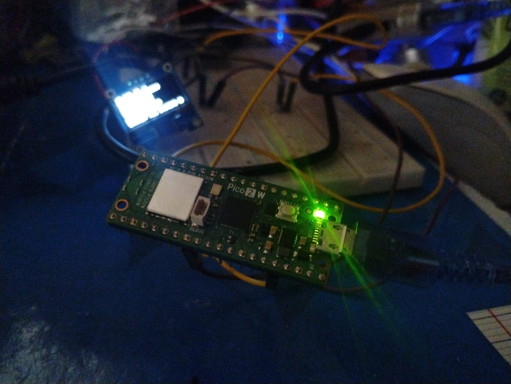
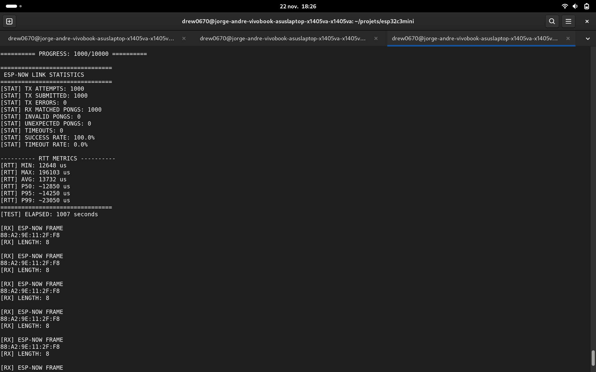

# Hazard3

> **RISC-V fork of Embassy.** Hazard3 is an independent fork of [Embassy](https://github.com/embassy-rs/embassy),
> maintained by [Jorge Andre Castro](https://github.com/jorgeandrecastro) at
> <https://github.com/jorgeandrecastro/Hazard3>. It adds RISC-V support, for example for the
> RP2350 Hazard3 cores, which upstream Embassy does not provide.
>
> The existing `hazard3-*` packages are published on crates.io. The library-name
> changes described here apply to the next releases.
> Every release of the former `*-riscv` packages is yanked; existing lockfiles may
> continue to use them, but new dependency resolution should use `hazard3-*`.



## ESP-NOW: flagship feature



[`hazard3-cyw43`](hazard3-cyw43/) and [`hazard3-cyw43-pio`](hazard3-cyw43-pio/) provide the fork's
main hardware feature: bidirectional ESP-NOW communication on the Raspberry Pi
Pico 2 W. The Pico 2 W uses the RP2350 Hazard3 core and the CYW43439 radio
through the RISC-V PIO transport, and communicates with an ESP32-C3 Mini using
PING/PONG action frames.

This ESP-NOW validation is available in `cyw43-riscv` 0.2.1 and
`cyw43-pio-riscv` 0.2.1. It was tested on hardware with sequence-number
validation, PONG matching, timeout detection and round-trip-time measurements.
In the recorded 1,000-exchange benchmark, all exchanges completed successfully
with zero transmission errors, invalid PONGs, unexpected PONGs and timeouts.

## Vision

Hazard3 is a **RISC-V-first** fork. The goal is to make async embedded Rust with Embassy a
first-class experience on RISC-V microcontrollers, starting with the Hazard3 cores of the RP2350.

- **RISC-V only.** This fork does not support Arm Cortex-M and does not support the RP2040
  (which has no RISC-V cores). Cortex-M code, features, dependencies and interrupt vector tables are
  removed rather than kept behind `cfg` flags. For Arm or RP2040, use upstream Embassy.
- **Publishable on crates.io.** The previously published fork packages are being renamed to
  `hazard3-*`; upstream crates outside this fork's published stack are not being renamed.
- **Consistent names.** Each Rust library uses its `hazard3-*` package name, with
  underscores in Rust imports (for example `hazard3_time`).

Use the `hazard3-*` crates **together** to avoid duplicate or incompatible copies of Embassy
dependencies. Check crates.io for each package's availability.

## Crates

| Package | Library name | Role |
|---|---|---|
| [`hazard3-rp`](hazard3-rp/) | `hazard3_rp` | RP2350 HAL |
| [`hazard3-rp-pac`](hazard3-rp-pac/) | `hazard3_rp_pac` | RP2350 PAC |
| [`hazard3-net-async`](hazard3-net-async/) | `hazard3_net_async` | Async networking stack |
| [`hazard3-cyw43`](hazard3-cyw43/) | `hazard3_cyw43` | CYW43 WiFi and Bluetooth driver |
| [`hazard3-cyw43-pio`](hazard3-cyw43-pio/) | `hazard3_cyw43_pio` | RP2350 PIO transport for CYW43 |
| [`hazard3-net-driver-channel`](hazard3-net-driver-channel/) | `hazard3_net_driver_channel` | Channel-based network drivers |
| [`hazard3-net`](hazard3-net/) | `hazard3_net` | Xarxa-derived network stack |
| [`hazard3-net-driver`](hazard3-net/hazard3-net-driver/) | `hazard3_net_driver` | Network driver interface |
| `hazard3-executor`, `hazard3-executor-macros`, `hazard3-executor-timer-queue` | `hazard3_executor`, `hazard3_executor_macros`, `hazard3_executor_timer_queue` | Executor |
| `hazard3-time`, `hazard3-time-driver`, `hazard3-time-queue-utils` | `hazard3_time`, `hazard3_time_driver`, `hazard3_time_queue_utils` | Timekeeping |
| `hazard3-sync` | `hazard3_sync` | Synchronization primitives |
| [`hazard3-futures`](hazard3-futures/) | `hazard3_futures` | Future combinators and utilities |
| `hazard3-embedded-hal` | `hazard3_embedded_hal` | `embedded-hal` adapters |
| `hazard3-usb-driver` | `hazard3_usb_driver` | USB driver traits |
| `hazard3-hal-internal` | `hazard3_hal_internal` | HAL internals |
| `hazard3-unitrait`, `hazard3-unitrait-macros` | `hazard3_unitrait`, `hazard3_unitrait_macros` | Global implementation traits |

For linking and flashing on the Pico 2 in RISC-V mode, use
[`rp2350-riscv-linker`](https://crates.io/crates/rp2350-riscv-linker) 0.2 or later.

## Package migration

| Former package | Hazard3 package |
|---|---|
| `embassy-rp-riscv` | `hazard3-rp` |
| `rp-pac-riscv` | `hazard3-rp-pac` |
| `embassy-net-riscv` | `hazard3-net-async` |
| `xarxa-riscv` | `hazard3-net` |
| `xarxa-driver-riscv` | `hazard3-net-driver` |
| `embassy-net-driver-channel-riscv` | `hazard3-net-driver-channel` |
| `cyw43-riscv` | `hazard3-cyw43` |
| `cyw43-pio-riscv` | `hazard3-cyw43-pio` |
| `embassy-executor-riscv` | `hazard3-executor` |
| `embassy-executor-macros-riscv` | `hazard3-executor-macros` |
| `embassy-executor-timer-queue-riscv` | `hazard3-executor-timer-queue` |
| `embassy-time-riscv` | `hazard3-time` |
| `embassy-time-driver-riscv` | `hazard3-time-driver` |
| `embassy-time-queue-utils-riscv` | `hazard3-time-queue-utils` |
| `embassy-sync-riscv` | `hazard3-sync` |
| `embassy-embedded-hal-riscv` | `hazard3-embedded-hal` |
| `embassy-usb-driver-riscv` | `hazard3-usb-driver` |
| `embassy-hal-internal-riscv` | `hazard3-hal-internal` |
| `unitrait-riscv` | `hazard3-unitrait` |
| `unitrait-macros-riscv` | `hazard3-unitrait-macros` |
| `embassy-futures` | `hazard3-futures` |

Replace old dependency keys and Rust imports, for example `embassy-time` and
`embassy_time`, with `hazard3-time` and `hazard3_time`. This is a source-breaking
change; previously published releases retain their old library names. See
the crate changelogs for the version-specific migration details. The executor's
`embassy-time-driver` feature is now `hazard3-time-driver`; update feature lists
as well as imports.

## Quick start

After releases containing these changes are published, use the new release
versions with these dependency names. Existing published versions still use
the old Rust library names:

```toml
[dependencies]
hazard3-rp = { version = "0.4", features = ["rp235xa", "time-driver", "critical-section-impl", "imagedef-none"] }
hazard3-time = "0.2"
hazard3-executor = { version = "0.2", features = ["platform-riscv32", "executor-thread"] }
hazard3-sync = "0.2"
rp2350-riscv-linker = "1.0.0"
```

```sh
rustup target add riscv32imac-unknown-none-elf
cargo build --release --target riscv32imac-unknown-none-elf
```

See the [`hazard3-rp` README](hazard3-rp/README.md) for the full setup.

## What is new

The following entries describe releases under the former package names.

### CYW43 ESP-NOW support 0.2.1 (2026-11-22)

- `cyw43-riscv` 0.2.1 adds the standalone Pico 2 W / ESP32-C3 example and benchmark references.
- `cyw43-pio-riscv` 0.2.1 documents and aligns the PIO transport with the ESP-NOW example.
- Validated bidirectional PING/PONG communication with an ESP32-C3 Mini.
- Recorded 1,000 successful exchanges, with no TX errors, invalid or unexpected PONGs, or timeouts.
- Average measured RTT was 13.732 ms; see the [CYW43 benchmark](hazard3-cyw43/README.md#esp-now-benchmark).

### embassy-rp-riscv 0.2.0 (2026-11-21)

- RISC-V only: Cortex-M and RP2040 features, dependencies, CPU primitives and startup code are removed.
- `riscv` feature enabled by default; RP2040 and non-RISC-V targets are rejected at compile time.
- Depends on `rp-pac-riscv` 0.2, which no longer ships the Cortex-M interrupt vector table. Trap and
  interrupt dispatch is delegated to the RISC-V runtime.
- Multicore now uses the RISC-V `SIO_IRQ_FIFO` interrupt instead of the Arm-only `SIO_IRQ_PROC1`.
- Checked with `cargo check` for `rp235xa` and `rp235xb` on `riscv32imac-unknown-none-elf`, including
  with `RUSTFLAGS="-D unexpected-cfgs"`.

### embassy-net-riscv 0.3.0 (2026-11-22)

- Now depends on the in-repository `xarxa-riscv` and `xarxa-driver-riscv` forks through local path
  dependencies instead of Git dependencies, which allows publication on crates.io.
- The monolithic `src/tcp.rs` is split into focused modules (`socket`, `socket/io`, `listener`,
  `client`). The public API and `tcp::` paths are unchanged, so this is not a breaking change.
- The DNS client now handles unsupported reverse lookups with `dns::Error::Unsupported` instead of
  panicking. DNS fallback behavior and host-name query handling are also updated.
- New TCP source files carry an `SPDX-License-Identifier: MIT OR Apache-2.0` header.

The detailed history is in each crate's `CHANGELOG.md`.

## RISC-V networking

[`hazard3-net-async`](hazard3-net-async/) brings Embassy networking to this RISC-V ecosystem.
It uses local, versioned network dependencies rather than Git dependencies.

This repository also provides the pinned Xarxa sources needed by `hazard3-net-async`:

- [`hazard3-net`](hazard3-net/) — network stack package.
- [`hazard3-net-driver`](hazard3-net/hazard3-net-driver/) — driver interface package.

The Rust library names are `hazard3_net_async`, `hazard3_net`, and
`hazard3_net_driver`, respectively.

These networking forks are published under the same repository and are not replacements for upstream
Xarxa or upstream Embassy outside RISC-V projects.

## Test and build scope

No maintained CI workflow, example build matrix, or hardware integration test suite is provided.

- `embassy-rp-riscv` is validated manually with `cargo check` on `riscv32imac-unknown-none-elf`
  (`rp235xa`, `rp235xb`, and a release check on `rp235xa`) and has been tested on a real RP2350 running
  the Hazard3 cores. Not every peripheral is tested, and PSRAM support is not implemented yet. The
  commands are listed in its README.
- [`cyw43-riscv`](hazard3-cyw43/) and [`cyw43-pio-riscv`](hazard3-cyw43-pio/) are available for the Raspberry Pi Pico 2 W
  and have been tested on hardware. The integration has been exercised for ESP-NOW bidirectional
  PING/PONG communication with an ESP32-C3 Mini, CYW43 LED blinking and use with an OLED display.
- The networking crate has been checked for the RISC-V target; this is not a hardware integration test.
- There is no maintained test suite or hardware integration check for the upstream network examples
  or target-specific networking configurations in this repository.

## Contributing

Issues and reports about odd behaviour, in particular on the Hazard3 interrupt code, are welcome in the
[issue tracker](https://github.com/jorgeandrecastro/Hazard3/issues). Changes that reintroduce
Arm or RP2040 support are out of scope for this fork.

## License

The Hazard3 Embassy-derived sources remain licensed under the upstream MIT OR Apache-2.0 terms:

- Apache License, Version 2.0 ([LICENSE-APACHE](LICENSE-APACHE))
- MIT license ([LICENSE-MIT](LICENSE-MIT))

The integrated [`hazard3-net`](hazard3-net/) and [`hazard3-net-driver`](hazard3-net/hazard3-net-driver/)
sources retain the upstream 0-Clause BSD license. The `hazard3-rp-pac` register definitions are generated
from the Pico SDK SVD files and keep their BSD-3-Clause license.

## Acknowledgements

Hazard3 is derivative work based on the Embassy project and the Xarxa project. All credit for
the original code goes to their respective authors and contributors:

- [Embassy](https://github.com/embassy-rs/embassy)
- [Xarxa](https://github.com/embassy-rs/xarxa)

The original copyright and license notices are preserved in the corresponding directories.
Hazard3 is not affiliated with or endorsed by the Embassy or Xarxa projects