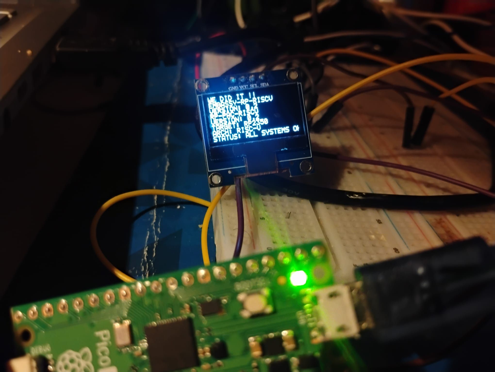

# Embassy-RISCV

> **RISC-V fork of Embassy.** This independent fork of [Embassy](https://github.com/embassy-rs/embassy)
> is maintained by [Jorge Andre Castro](https://github.com/jorgeandrecastro) at
> <https://github.com/jorgeandrecastro/embassy-riscv>. It adds RISC-V support, for example for the
> RP2350 Hazard3 cores, which upstream Embassy does not provide.



## Vision

Embassy-RISCV is a **RISC-V-first** fork. The goal is to make async embedded Rust with Embassy a
first-class experience on RISC-V microcontrollers, starting with the Hazard3 cores of the RP2350.

- **RISC-V only.** This fork does not support Arm Cortex-M and does not support the RP2040
  (which has no RISC-V cores). Cortex-M code, features, dependencies and interrupt vector tables are
  removed rather than kept behind `cfg` flags. For Arm or RP2040, use upstream Embassy.
- **Publishable on crates.io.** Upstream crates that depend on Git revisions or unreleased changes
  are republished under `-riscv` package names so the whole stack can be used from crates.io.
- **Source compatible.** The Rust library names stay the same as upstream (`embassy_time`,
  `embassy_executor`, `embassy_rp`, `embassy_net`, `rp_pac`, ...), so only the `package = "..."` key
  changes in `Cargo.toml`.

Use the `-riscv` crates **together** to avoid duplicate or incompatible copies of Embassy dependencies.

## Crates

| Package | Library name | Role |
|---|---|---|
| [`embassy-rp-riscv`](embassy-rp/) | `embassy_rp` | RP2350 (RP235x) HAL for the Hazard3 RISC-V cores |
| `rp-pac-riscv` | `rp_pac` | RP2350 PAC, RISC-V only, no Cortex-M vector table |
| [`embassy-net-riscv`](embassy-net/) | `embassy_net` | Async networking stack |
| [`xarxa-riscv`](xarxa-riscv/) | `xarxa` | Network stack, pinned upstream sources |
| [`xarxa-driver-riscv`](xarxa-riscv/xarxa-driver/) | `xarxa_driver` | Network driver interface |
| `embassy-executor-riscv`, `embassy-executor-macros-riscv` | `embassy_executor` | Executor |
| `embassy-time-riscv`, `embassy-time-driver-riscv` | `embassy_time`, `embassy_time_driver` | Timekeeping |
| `embassy-sync-riscv` | `embassy_sync` | Synchronization primitives |
| `embassy-embedded-hal-riscv` | `embassy_embedded_hal` | `embedded-hal` adapters |
| `embassy-usb-driver-riscv` | `embassy_usb_driver` | USB driver traits |
| `embassy-hal-internal-riscv` | `embassy_hal_internal` | HAL internals, including Hazard3 `Xh3irq` interrupts |

For linking and flashing on the Pico 2 in RISC-V mode, use
[`rp2350-riscv-linker`](https://crates.io/crates/rp2350-riscv-linker) 0.2 or later.

## Quick start

```toml
[dependencies]
embassy-rp = { package = "embassy-rp-riscv", version = "0.2", features = ["rp235xa", "time-driver", "critical-section-impl", "imagedef-none"] }
embassy-time = { package = "embassy-time-riscv", version = "0.1" }
embassy-executor = { package = "embassy-executor-riscv", version = "0.1", features = ["platform-riscv32", "executor-thread"] }
embassy-sync = { package = "embassy-sync-riscv", version = "0.1" }
rp2350-riscv-linker = "1.0.0"
```

```sh
rustup target add riscv32imac-unknown-none-elf
cargo build --release --target riscv32imac-unknown-none-elf
```

See the [`embassy-rp-riscv` README](embassy-rp/README.md) for the full setup.

## What is new

### embassy-rp-riscv 0.2.0 (2026-11-21)

- RISC-V only: Cortex-M and RP2040 features, dependencies, CPU primitives and startup code are removed.
- `riscv` feature enabled by default; RP2040 and non-RISC-V targets are rejected at compile time.
- Depends on `rp-pac-riscv` 0.2, which no longer ships the Cortex-M interrupt vector table. Trap and
  interrupt dispatch is delegated to the RISC-V runtime.
- Multicore now uses the RISC-V `SIO_IRQ_FIFO` interrupt instead of the Arm-only `SIO_IRQ_PROC1`.
- Checked with `cargo check` for `rp235xa` and `rp235xb` on `riscv32imac-unknown-none-elf`, including
  with `RUSTFLAGS="-D unexpected-cfgs"`.

### embassy-net-riscv 0.1.0 (2026-11-20)

- Now depends on the in-repository `xarxa-riscv` and `xarxa-driver-riscv` forks through local path
  dependencies instead of Git dependencies, which allows publication on crates.io.
- The monolithic `src/tcp.rs` is split into focused modules (`socket`, `socket/io`, `listener`,
  `client`). The public API and `tcp::` paths are unchanged, so this is not a breaking change.
- Adds unit tests in every TCP module, which upstream `embassy-net` does not have: error types
  and `embedded-io` error mapping, the TCP client connection buffer pool, and compile-time checks of
  the public API signatures and `embedded-io` trait impls.
- New TCP source files carry an `SPDX-License-Identifier: MIT OR Apache-2.0` header.

The detailed history is in each crate's `CHANGELOG.md`.

## RISC-V networking

[`embassy-net-riscv`](embassy-net/) is required to bring Embassy networking to this RISC-V ecosystem.
It cannot publish successfully when it depends directly on upstream Git dependencies, and it must be
aligned with the other `-riscv` crates.

This repository also provides the pinned Xarxa sources needed by `embassy-net-riscv`:

- [`xarxa-riscv`](xarxa-riscv/) — network stack package.
- [`xarxa-driver-riscv`](xarxa-riscv/xarxa-driver/) — driver interface package.

The Rust library names remain unchanged: `embassy_net`, `xarxa`, and `xarxa_driver`. Cargo users
must select the forked packages with `package = "embassy-net-riscv"`,
`package = "xarxa-riscv"`, or `package = "xarxa-driver-riscv"` as appropriate.

These networking forks are published under the same repository and are not replacements for upstream
Xarxa or upstream Embassy outside RISC-V projects.

## Test and build scope

No maintained CI workflow, example build matrix, or hardware integration test suite is provided.

- `embassy-rp-riscv` is validated manually with `cargo check` on `riscv32imac-unknown-none-elf`
  (`rp235xa`, `rp235xb`, and a release check on `rp235xa`) and has been tested on a real RP2350 running
  the Hazard3 cores. Not every peripheral is tested, and PSRAM support is not implemented yet. The
  commands are listed in its README.
- The networking crates do not compile or test upstream examples and target-specific hardware
  integrations in this repository. Their host-oriented checks and development commands, including the
  new TCP unit tests, are documented in the individual crate READMEs.

## Contributing

Issues and reports about odd behaviour, in particular on the Hazard3 interrupt code, are welcome in the
[issue tracker](https://github.com/jorgeandrecastro/embassy-riscv/issues). Changes that reintroduce
Arm or RP2040 support are out of scope for this fork.

## License

The Embassy-RISCV sources remain licensed under the upstream MIT OR Apache-2.0 terms:

- Apache License, Version 2.0 ([LICENSE-APACHE](LICENSE-APACHE))
- MIT license ([LICENSE-MIT](LICENSE-MIT))

The integrated [`xarxa-riscv`](xarxa-riscv/) and [`xarxa-driver-riscv`](xarxa-riscv/xarxa-driver/)
sources retain the upstream 0-Clause BSD license. The `rp-pac-riscv` register definitions are generated
from the Pico SDK SVD files and keep their BSD-3-Clause license.

## Acknowledgements

Embassy-RISCV is derivative work based on the Embassy project and the Xarxa project. All credit for
the original code goes to their respective authors and contributors:

- [Embassy](https://github.com/embassy-rs/embassy)
- [Xarxa](https://github.com/embassy-rs/xarxa)

The original copyright and license notices are preserved in the corresponding directories.
Embassy-RISCV is not affiliated with or endorsed by the Embassy or Xarxa projects.