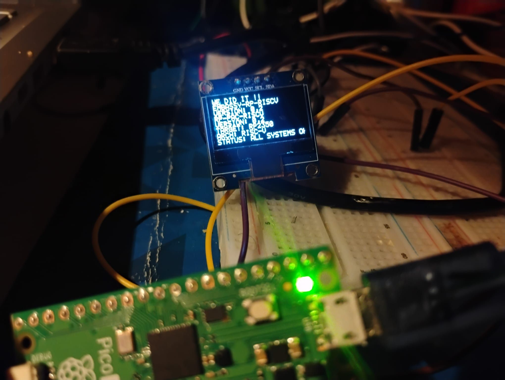

# Embassy RP HAL

[](https://crates.io/crates/embassy-rp-riscv)
[](https://docs.rs/embassy-rp-riscv)
[](https://opensource.org/licenses/MIT)

> **RISC-V fork of Embassy.** This is an independent fork of [Embassy](https://github.com/embassy-rs/embassy) maintained by
> [Jorge Andre Castro](https://github.com/jorgeandrecastro) at <https://github.com/jorgeandrecastro/embassy-riscv>.
> It adds RISC-V support (e.g. RP2350 Hazard3 cores) which is not provided upstream. All credit for Embassy goes to the
> Embassy team and contributors. Licensed under the same terms as upstream (MIT OR Apache-2.0). Not affiliated with or endorsed by the Embassy project.



HALs implement safe, idiomatic Rust APIs to use the hardware capabilities, so raw register manipulation is not needed.

The embassy-rp-riscv HAL targets the RP235x microcontroller's Hazard3 RISC-V cores. The HAL implements both blocking and async APIs
for many peripherals. The benefit of using the async APIs is that the HAL takes care of waiting for peripherals to
complete operations in low power mode and handling interrupts, so that applications can focus on more important matters.

* [embassy-rp-riscv on crates.io](https://crates.io/crates/embassy-rp-riscv)
* [Documentation](https://docs.rs/embassy-rp-riscv)
* [Source](https://github.com/jorgeandrecastro/embassy-riscv/tree/main/embassy-rp)
* [Examples](https://github.com/jorgeandrecastro/embassy-riscv/tree/main/examples/rp/src/bin)
* [Changelog](./CHANGELOG.md)

## RISC-V support (RP2350 Hazard3)

The RP2350 has two Arm Cortex-M33 cores **and** two Hazard3 RISC-V cores (you pick one pair at boot). Upstream `embassy-rp` only
supports the Arm cores. This fork targets **only** the Hazard3 cores; use upstream `embassy-rp` for Arm and for the RP2040.

### What this fork does

* **RISC-V only (since 0.2.0).** All Cortex-M and RP2040 features, dependencies, CPU primitives and startup code have been removed. The crate rejects RP2040 and non-RISC-V targets at compile time.
* `riscv` Cargo feature, enabled by default.
* `cpu.rs`: Hazard3 CPU primitives (`nop`, `delay`, `sev`, `wfe`, interrupt enable/disable...).
* `arch.rs`: Hazard3 startup code. `install_core0_stack_guard()` is a no-op returning `Ok(())` (no MPU/MSPLIM).
* Interrupts through the Hazard3 `Xh3irq` extension (custom CSRs `meiea`, `meipa`, `meifa`, `meipra`, `meinext`), provided by [`embassy-hal-internal-riscv`](https://crates.io/crates/embassy-hal-internal-riscv). `embassy_rp::init()` enables machine external interrupts.
* Time driver ported to RISC-V.
* Multicore ported to RISC-V: `spawn_core1`, `pause_core1` and `resume_core1` rely on the inter-core FIFO, which uses the RISC-V `SIO_IRQ_FIFO` interrupt (the Arm-only `SIO_IRQ_PROC1` reference was removed in 0.2.0).

### Supported chips and features

| Feature | Description |
|---|---|
| `rp235xa` | RP2350A / RP2354A |
| `rp235xb` | RP2350B / RP2354B |
| `riscv` | Hazard3 support (default) |
| `rt` | Runtime support |
| `time-driver` | Use the TIMER peripheral as `embassy-time` driver (1 MHz) |
| `critical-section-impl` | Provide a `critical-section` implementation |
| `imagedef-none` | Do not embed an image definition (provided by `rp2350-riscv-linker`) |
| `defmt` | `defmt` logging support |
| `unstable-pac` | Expose the PAC |

You must select exactly one chip feature (`rp235xa` or `rp235xb`).

### Usage

Select the chip:

```toml
[dependencies]
embassy-rp = { package = "embassy-rp-riscv", version = "0.2", features = ["rp235xa", "time-driver", "critical-section-impl", "imagedef-none"] }
rp2350-riscv-linker = "0.2"
```

Build for the Hazard3 target (`riscv32imac-unknown-none-elf`):

```sh
rustup target add riscv32imac-unknown-none-elf
cargo doc --no-default-features --target riscv32imac-unknown-none-elf --features riscv,rt,rp235xa,defmt,unstable-pac,time-driver
cargo build --release --target riscv32imac-unknown-none-elf
```

You also need a RISC-V runtime (for example `riscv-rt` 0.18) and a `memory.x` / RP2350 RISC-V boot image definition.
Use [`rp2350-riscv-linker`](https://crates.io/crates/rp2350-riscv-linker) (**version 0.2 or later**, `0.1` is not compatible) for this: it generates `memory.x`
at compile time and adds the `.start_block` image definition needed by `picotool`. It has been tested together with this fork on a Pico 2 in RISC-V mode.
Its README contains a working `.cargo/config.toml`, a complete dependency setup and a flashing script (`picotool uf2 convert ... --family rp2350-riscv`).

```rust
#![no_std]
#![no_main]

use rp2350_riscv_linker as _;
```

For Arm builds, use upstream `embassy-rp`.

On RISC-V, `bind_interrupts!`-style handlers are resolved through a weak-symbol dispatch table: an interrupt with no handler
bound calls a default handler that hangs, so it is noticed. There is no Cortex-M vector table: trap and interrupt dispatch is delegated to the RISC-V runtime.

### Development

Checks used to validate the crate on the Hazard3 target:

```sh
# RP2350A
cargo check \
    --target riscv32imac-unknown-none-elf \
    --no-default-features \
    --features "rp235xa riscv rt time-driver"

# RP2350B
cargo check \
    --target riscv32imac-unknown-none-elf \
    --no-default-features \
    --features "rp235xb riscv rt time-driver"

# RP2350A, release profile
cargo check --release \
    --target riscv32imac-unknown-none-elf \
    --no-default-features \
    --features "rp235xa riscv rt time-driver"
```

To make sure no stale `cfg` (for example a leftover Arm or RP2040 one) remains, treat unexpected `cfg` as errors:

```sh
RUSTFLAGS="-D unexpected-cfgs" cargo check \
    --target riscv32imac-unknown-none-elf \
    --no-default-features \
    --features "rp235xb riscv rt time-driver"
```

Building for a non-RISC-V target (or for the RP2040) is rejected on purpose.

### Why the extra `rp-pac-riscv` crate

Upstream `embassy-rp` uses a git revision of `rp-pac` that is newer than the one on crates.io, and crates.io does not accept git dependencies.
To make `embassy-rp-riscv` publishable, that revision is republished as [`rp-pac-riscv`](https://crates.io/crates/rp-pac-riscv)
(same `rp_pac` library name). Its register definitions are unchanged, but Cortex-M dependencies and the interrupt vector table have been removed
(since `rp-pac-riscv` 0.2). It is a dependency of this crate; you do not need to add it yourself.

### Companion `-riscv` crates

Upstream `embassy-rp` at this commit needs unreleased changes of several Embassy crates (the versions on crates.io are older), so unmodified copies
of them are republished with a `-riscv` suffix. Their library names are unchanged (`embassy_time`, `embassy_executor`, ...). Use **all** of them
together in your application, with `package = "..."`, to avoid duplicate or incompatible copies of the same crate:

`embassy-sync-riscv`, `embassy-time-riscv`, `embassy-time-driver-riscv`, `embassy-executor-riscv`, `embassy-executor-macros-riscv`,
`embassy-embedded-hal-riscv`, `embassy-usb-driver-riscv`, `embassy-hal-internal-riscv`, `rp-pac-riscv`.

```toml
embassy-time = { package = "embassy-time-riscv", version = "0.1" }
embassy-executor = { package = "embassy-executor-riscv", version = "0.1", features = ["platform-riscv32", "executor-thread"] }
embassy-sync = { package = "embassy-sync-riscv", version = "0.1" }
```

### Status and limitations

* Tested on a real RP2350 running the RISC-V cores. Other peripherals are expected to work as on Arm, but are not all tested.
* RP2040 has no RISC-V cores and is not supported: use upstream `embassy-rp`.
* Cortex-M33 (Arm) mode of the RP2350 is not supported: use upstream `embassy-rp`.
* PSRAM support is not implemented yet.
* The `embassy-crypto-rng` feature of upstream was removed.
* 0.2.0 is validated with `cargo check` on `riscv32imac-unknown-none-elf` for both `rp235xa` and `rp235xb` (features `riscv`, `rt`, `time-driver`). See [Development](#development).
* The build still emits 8 compiler warnings (checked with `rp235xb`) that do not prevent compilation: 7 come from the unfinished PSRAM code in `src/psram.rs` (unreachable code, unused variables and constants, unnecessary `mut`) and 1 is a missing doc comment on `div_int` in `src/clocks.rs`.
* The Hazard3 interrupt code was written from the RP2350 datasheet; report odd behaviour in the [issue tracker](https://github.com/jorgeandrecastro/embassy-riscv/issues).

## Credits and license

This crate is based on [`embassy-rp`](https://github.com/embassy-rs/embassy/tree/main/embassy-rp) from the Embassy project; all credit
for the HAL goes to the Embassy team and contributors. Licensed under either of Apache License 2.0 or MIT, at your option, like upstream.

## `embassy-time` time driver

If the `time-driver` feature is enabled, the HAL uses the TIMER peripheral as a global time driver for [embassy-time](https://crates.io/crates/embassy-time), with a tick rate of 1MHz.

## Embedded-hal

The `embassy-rp` HAL implements the traits from [embedded-hal](https://crates.io/crates/embedded-hal) (v0.2 and 1.0) and [embedded-hal-async](https://crates.io/crates/embedded-hal-async), as well as [embedded-io](https://crates.io/crates/embedded-io) and [embedded-io-async](https://crates.io/crates/embedded-io-async).

## Interoperability

This crate can run on any executor.

Optionally, some features requiring [`embassy-time`](https://crates.io/crates/embassy-time) can be activated with the `time-driver` feature. If you enable it,
you must link an `embassy-time` driver in your project.

## Acknowledgements

This crate is a derivative work of the [Embassy](https://embassy.dev) project ([embassy-rs/embassy](https://github.com/embassy-rs/embassy)),
Copyright (c) Embassy project contributors, used under the MIT OR Apache-2.0 licenses. The original copyright and license notices are
kept (see `LICENSE-MIT` and `LICENSE-APACHE`). Embassy and its authors are not affiliated with, and do not endorse, this fork.
Thank you to the Embassy team and contributors for their work.