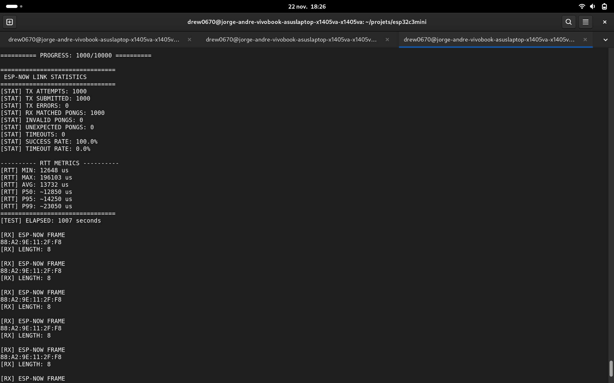

# hazard3-cyw43-pio

> **Migration in progress:** `hazard3-cyw43-pio` replaces the formerly published `cyw43-pio-riscv`.
> See the project repository for the publication status of the Hazard3 packages.
> Rust library names and upstream license and attribution notices are retained.

RISC-V fork of Embassy's PIO driver for the CYW43 half-duplex SPI bus on the
RP2350, including the Pico 2 W. It uses `hazard3-rp` and `hazard3-cyw43`;
it does not support RP2040 or Arm.

## ESP-NOW RISC-V transport



`hazard3-cyw43-pio` provides the RP2350 PIO half-duplex SPI transport used by
[`hazard3-cyw43`](../hazard3-cyw43/) for ESP-NOW action-frame communication. This is a
key hardware feature of the fork: a Raspberry Pi Pico 2 W exchanges PING/PONG
ESP-NOW frames bidirectionally with an ESP32-C3 Mini.

Standalone source examples and the benchmark report are available in
[`cyw43-riscv/exemples/espnow-pico2w`](../hazard3-cyw43/exemples/espnow-pico2w/README.md)
and [`Benchmraks.md`](../hazard3-cyw43/exemples/espnow-pico2w/Benchmraks.md). The PIO
package itself is not expanded with those example binaries.

The transport uses separate TX and RX DMA channels to communicate reliably
with the CYW43439. The ESP-NOW validation exercises action-frame reception,
response transmission, sequence-number matching, timeout handling and RTT
measurement. It is an experimental hardware feature, not a standard
ESP-NOW API from upstream Embassy.

The package name changes, but the Rust library name and API remain `cyw43_pio`.
Use the matching forked packages together:

```toml
[dependencies]
cyw43 = { package = "hazard3-cyw43", version = "0.2.1" }
cyw43-pio = { package = "hazard3-cyw43-pio", version = "0.2.1" }
embassy-rp = { package = "hazard3-rp", version = "0.2", features = ["rp235xa"] }
```

Select `rp235xb` instead for an RP2350B. The current `PioSpi::new` takes
separate TX and RX DMA channels and a clock divider scaled by 256, as in the
in-repository upstream-derived implementation. The fork uses the upstream
MIT OR Apache-2.0 licenses.

## Development

Run these commands from the `hazard3-cyw43-pio` directory. Install the RISC-V target if needed:

```sh
rustup target add riscv32imac-unknown-none-elf
```

Check the integration with the HAL, CYW43 driver and RISC-V networking stack:

```sh
# RP2350A
cargo check --test compatibility --target riscv32imac-unknown-none-elf --features embassy-rp/rp235xa

# RP2350B with defmt
cargo check --test compatibility --target riscv32imac-unknown-none-elf --features embassy-rp/rp235xb,defmt
```

Generate the documentation:

```sh
cargo doc \
    --target riscv32imac-unknown-none-elf \
    --features embassy-rp/rp235xa \
    --no-deps \
    --document-private-items
```

Package and publish with the RP2350A target configuration:

```sh
cargo package \
    --target riscv32imac-unknown-none-elf \
    --features embassy-rp/rp235xa
cargo publish \
    --target riscv32imac-unknown-none-elf \
    --features embassy-rp/rp235xa
```

## Credits

This crate is derived from [Embassy's `cyw43-pio`](https://github.com/embassy-rs/embassy/tree/main/cyw43-pio).
All credit for the original work goes to Embassy and its contributors. This
independent fork focuses on RISC-V and is not affiliated with or endorsed by Embassy.
