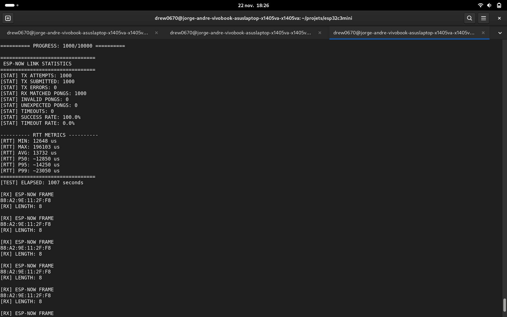

# hazard3-cyw43

> **Migration in progress:** `hazard3-cyw43` replaces the formerly published `cyw43-riscv`.
> See the project repository for the publication status of the Hazard3 packages.
> Rust library names and upstream license and attribution notices are retained.

RISC-V fork of the Embassy CYW43 WiFi and Bluetooth driver, based on [Embassy's `cyw43`](https://github.com/embassy-rs/embassy/tree/main/cyw43).

The package is named `hazard3-cyw43`, while the Rust library name remains `cyw43`.

This fork targets RISC-V and uses forked time, synchronization, and network channel crates. The RP2350 PIO transport is provided by [`hazard3-cyw43-pio`](../hazard3-cyw43-pio).

Licensed under MIT OR Apache-2.0.

## ESP-NOW RISC-V validation



Bidirectional ESP-NOW communication between a Raspberry Pi Pico 2 W running
CYW43-RISC-V and an ESP32-C3 Mini is the distinguishing hardware feature of
this fork compared with upstream Embassy's CYW43 driver.

## Supported hardware

- Raspberry Pi Pico 2 W (RP2350A).
- Pimoroni Pico Plus 2 W (RP2350B).
- Any board using the Raspberry Pi RM2 radio module.
- Other boards using the CYW43439 chip, and potentially compatible devices implementing a sufficiently similar protocol.

The RP2350 PIO transport supports the nonstandard half-duplex SPI communication required by the Pico 2 W.

## Features

### WiFi

Working:

- Station mode (joining an access point).
- Access Point mode with open, WPA2, WPA3, and WPA2/WPA3 transition-mode security.
- WiFi scanning.
- Sending and receiving Ethernet frames.
- Default MAC address support.
- [`embassy-net`](https://embassy.dev) integration.
- RP2350 PIO driver for half-duplex SPI.
- Interrupt-driven device events instead of busy polling.
- GPIO support, including the onboard LED.

WPA3 requires compatible CYW43 firmware and client support.

### Bluetooth

Working:

- Bluetooth Classic and LE HCI commands.
- Concurrent operation with WiFi.
- Implementation of [`bt-hci`](https://crates.io/crates/bt-hci) controller traits.
- Compatibility with the [TrouBLE](https://github.com/embassy-rs/trouble) Bluetooth LE stack.

See the TrouBLE repository for examples using `cyw43`.

### ESP-NOW experimental validation

The CYW43439 radio was also validated in an ESP-NOW bidirectional communication setup.

The experiment uses:

- Raspberry Pi Pico 2 W (RP2350 + CYW43439) as the receiving and responding device.
- ESP32-C3 Mini as the transmitting device.
- ESP-NOW action frames for PING/PONG communication.
- Sequence-number validation.
- Round-trip time (RTT) measurements.
- Packet statistics and timeout detection.

The RP2350 receives ESP-NOW action frames through the CYW43 driver, validates the PING payload, constructs a PONG response, and transmits it through the CYW43439.

This is an experimental hardware validation, not a claim that ESP-NOW is a standard feature of the upstream Embassy driver API.

## ESP-NOW examples and benchmarks

The repository includes standalone source examples for both devices:

- [Pico 2 W / ESP32-C3 ESP-NOW example](exemples/espnow-pico2w/README.md)
- [ESP-NOW benchmark report](exemples/espnow-pico2w/Benchmraks.md)

The examples are reference projects and are excluded from the published
`hazard3-cyw43` package archive, keeping the crate package and binaries free of
the example toolchains and benchmark sources.

## ESP-NOW benchmark

### Hardware configuration

| Component | Configuration |
|---|---|
| Receiver | Raspberry Pi Pico 2 W |
| MCU | RP2350 |
| Radio | CYW43439 |
| Transmitter | ESP32-C3 Mini |
| Protocol | ESP-NOW |
| WiFi channel | 1 |
| Payload | 8 bytes |
| Message interval | 1 second |
| PONG timeout | 500 ms |
| RX polling interval | 10 ms |

### Communication protocol

The experiment uses two 8-byte application payloads.

PING:

| Offset | Size | Description |
|---|---:|---|
| 0–3 | 4 bytes | ASCII `PING` |
| 4–7 | 4 bytes | Sequence number (`u32`, little-endian) |

PONG:

| Offset | Size | Description |
|---|---:|---|
| 0–3 | 4 bytes | ASCII `PONG` |
| 4–7 | 4 bytes | Echoed sequence number (`u32`, little-endian) |

The Pico 2 W validates each received PING and returns a PONG containing the original sequence number.

The ESP32-C3 matches each received PONG against its pending PING and measures the round-trip time.

### Measured results

<sub>Hardware test results captured on 22 November 2026.</sub>

The benchmark configuration targeted 10,000 exchanges. The recorded measurement below corresponds to the first 1,000 exchanges.

| Metric | Measured result |
|---|---:|
| Completed exchanges | 1,000 |
| TX attempts | 1,000 |
| TX submissions | 1,000 |
| TX errors | 0 |
| Matched PONGs | 1,000 |
| Invalid PONGs | 0 |
| Unexpected PONGs | 0 |
| Timeouts | 0 |
| Success rate | 100.0% |
| Timeout rate | 0.0% |
| Elapsed time | 1,007 seconds |

### Round-trip time (RTT)

| Metric | Result |
|---|---:|
| Minimum RTT | 12.648 ms |
| Maximum RTT | 196.103 ms |
| Average RTT | 13.732 ms |
| P50 | ~12.850 ms |
| P95 | ~14.250 ms |
| P99 | ~23.050 ms |

The measured RTT includes the complete application-level round trip, including radio communication, driver processing, scheduling, and response handling. It is not a measurement of pure RF propagation latency.

The maximum RTT indicates occasional latency spikes. The percentile measurements provide a more representative view of typical communication performance.

### Benchmark conclusions

The recorded experiment demonstrates:

- Successful ESP-NOW bidirectional communication.
- Correct PING/PONG payload parsing.
- Sequence-number matching.
- Successful response transmission through the CYW43439.
- No detected invalid or unexpected PONGs in the measured sample.
- No detected transmission errors or timeouts in the measured sample.
- Consistent RTT measurements with a 13.732 ms average.

These results validate the experimental communication path between the ESP32-C3 and the RP2350/CYW43439 platform under the tested conditions.

They do not establish long-term reliability, maximum throughput, or performance at different distances.

## Source layout

```text
hazard3-cyw43/
├── Cargo.toml
├── Cargo.lock
├── CHANGELOG.md
├── README.md
├── exemples/
│   └── espnow-pico2w/
├── src/
│   ├── lib.rs
│   ├── bluetooth.rs
│   ├── bluetooth_tests.rs
│   ├── chip.rs
│   ├── consts.rs
│   ├── control.rs
│   ├── countries.rs
│   ├── events.rs
│   ├── fmt.rs
│   ├── ioctl.rs
│   ├── runner.rs
│   ├── sdio.rs
│   ├── spi.rs
│   ├── structs.rs
│   └── util.rs
└── target/
```

## Development

Run these commands from the `hazard3-cyw43` directory.

Install the RISC-V target:

```sh
rustup target add riscv32imac-unknown-none-elf
```

Check the driver for RISC-V:

```sh
cargo check --target riscv32imac-unknown-none-elf
```

Check Bluetooth, defmt, and firmware logging:

```sh
cargo check \
    --target riscv32imac-unknown-none-elf \
    --features bluetooth,defmt,firmware-logs
```

Run host tests:

```sh
cargo test --features bluetooth
```

Generate documentation:

```sh
cargo doc \
    --target riscv32imac-unknown-none-elf \
    --features bluetooth,defmt,firmware-logs \
    --no-deps \
    --document-private-items
```

## Publishing

Publish `hazard3-net-driver-channel` first, then package and publish this crate:

```sh
cargo package --target riscv32imac-unknown-none-elf
cargo publish --target riscv32imac-unknown-none-elf
```

## Credits

This crate is derived from [Embassy's `cyw43`](https://github.com/embassy-rs/embassy/tree/main/cyw43).

All credit for the original driver goes to Embassy and its contributors.

This independent fork focuses on RISC-V compatibility and is not affiliated with or endorsed by the Embassy project.